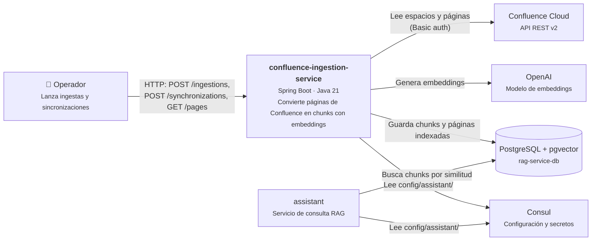
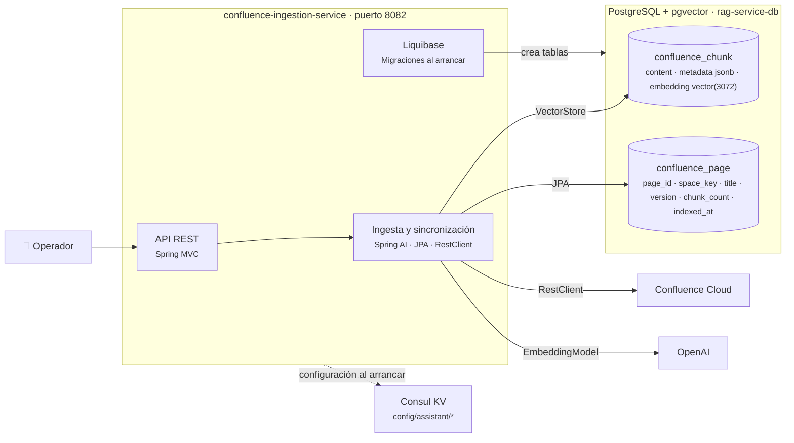
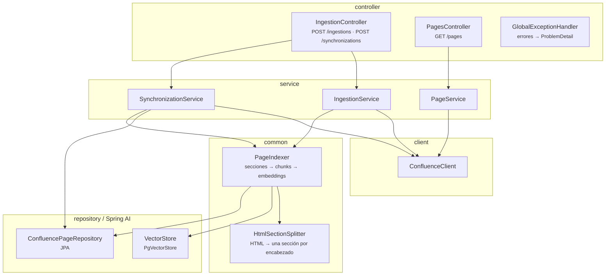
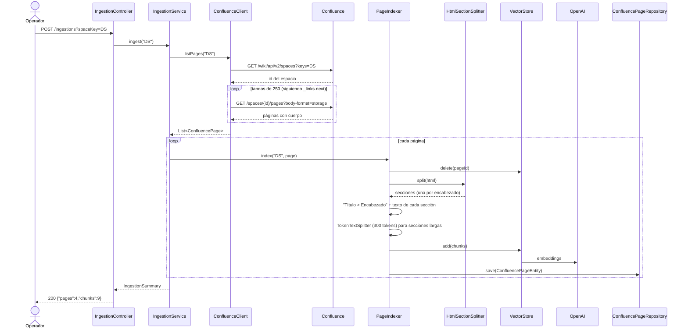
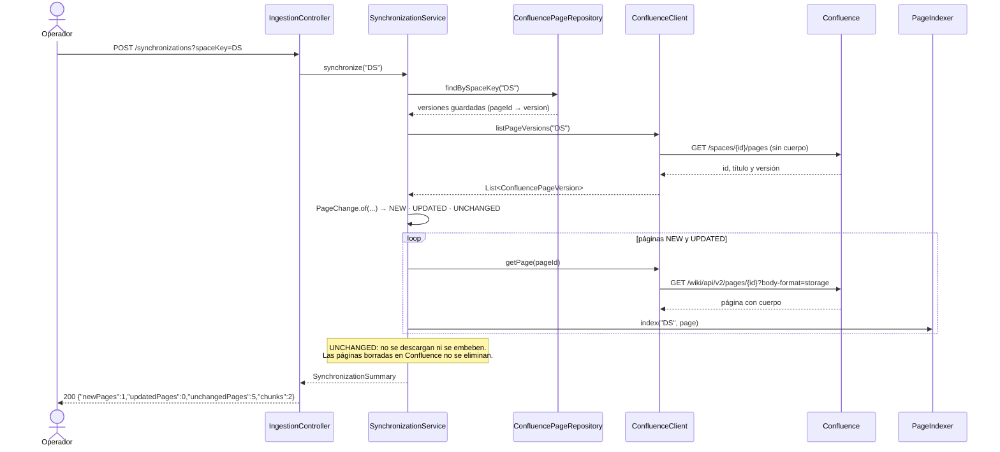
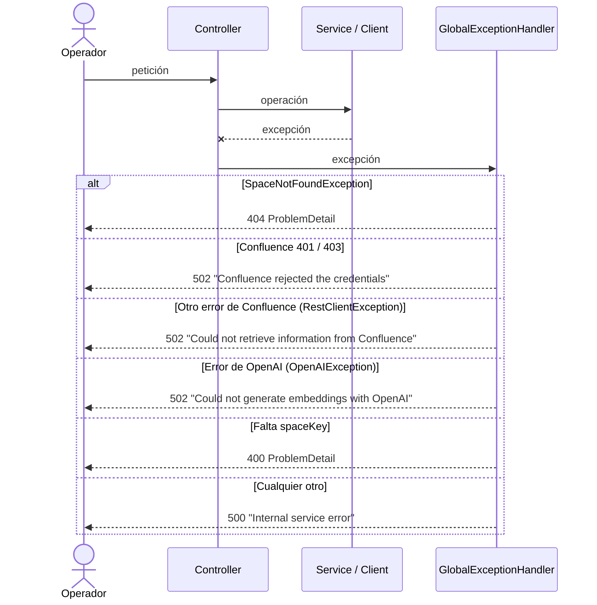
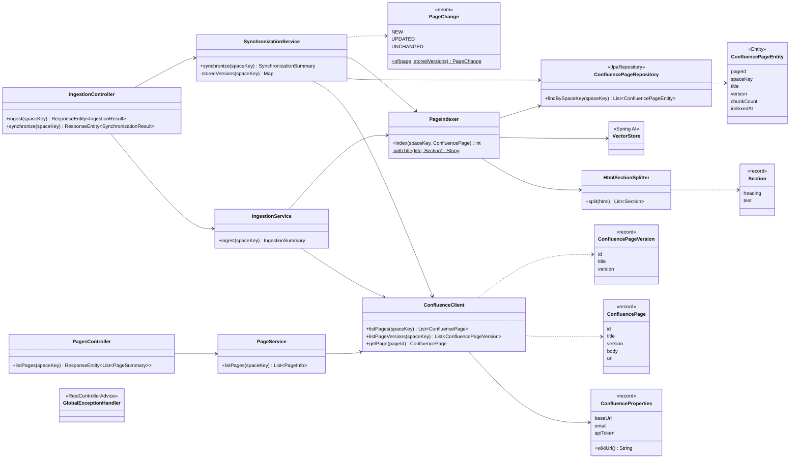

# Arquitectura de confluence-ingestion-service

Diagramas del diseño actual: C4 (contexto, contenedores y componentes), secuencia de las
operaciones y clases. Están en Mermaid, así que se ven directamente en GitHub o GitLab.

## C4 nivel 1: contexto

## C4 nivel 2: contenedores

## C4 nivel 3: componentes

Cada capa tiene sus propios modelos y mappers (MapStruct): `client/dto` para el JSON de
Confluence, `common/model` para lo que comparten client y services, `service/model` para lo que
devuelven los services y `controller/dto` para las respuestas de la API.

## Secuencia: ingesta completa

`POST /ingestions?spaceKey=DS` indexa todas las páginas del espacio, hayan cambiado o no.

## Secuencia: sincronización

`POST /synchronizations?spaceKey=DS` solo descarga e indexa las páginas nuevas o con otra versión.

## Secuencia: errores

## Diagrama de clases

Para no sobrecargar el diagrama se omiten los mappers de MapStruct, los DTOs de cada capa y las
clases de constantes (`ApiPaths`, `ConfluenceApi`, `ChunkMetadata`, `ErrorMessages`).
